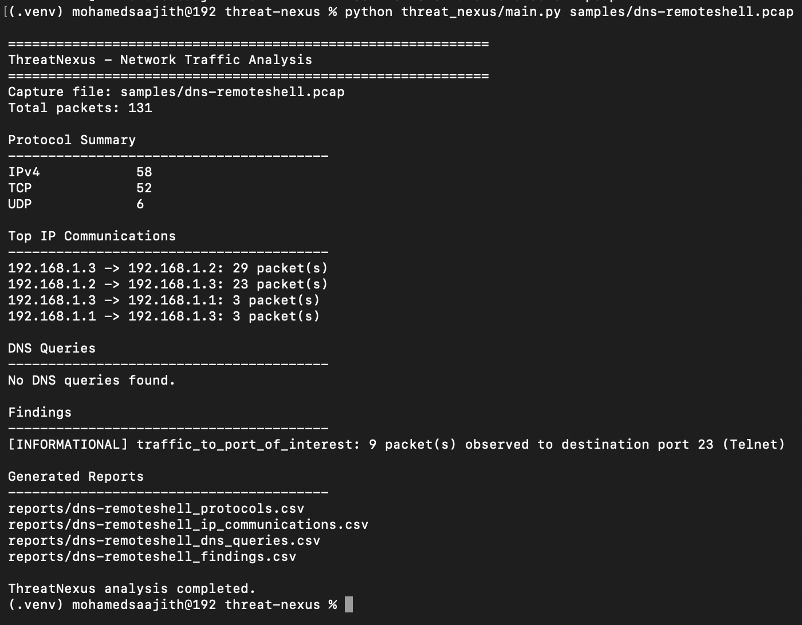
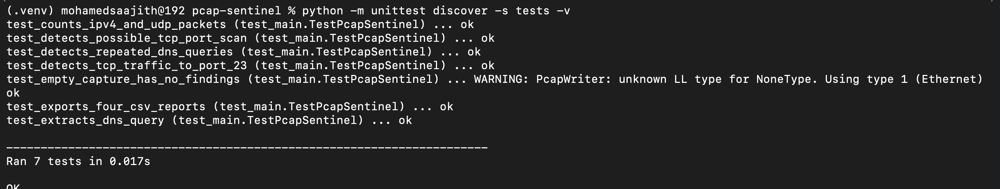

<div align="center">

# 🛡️ ThreatNexus

### Python-Based Network Traffic Analysis & Threat Detection

**Inspect. Analyse. Investigate.**

A lightweight cybersecurity tool for analysing PCAP/PCAPNG captures, summarising network communications, identifying potential indicators of suspicious activity, and generating CSV reports.


**[Explore the Repository](https://github.com/Saajith2004/threat-nexus)**

</div>

---

## 📌 Overview

ThreatNexus is a Python-based network traffic analysis project developed to strengthen practical skills in cybersecurity, packet analysis, and security automation.

It reads network capture files and produces summaries of observed protocols, IP communications, and DNS queries. It also applies lightweight detection rules to identify traffic patterns that may deserve further investigation.

> **Important:** Detection results are heuristic indicators, not proof of malicious activity. Investigate findings in the context of the environment and surrounding traffic.

## 📸 Application in Action

### 1. Network Traffic Analysis

ThreatNexus analyses PCAP and PCAPNG files to summarise network traffic, identify communication patterns, extract DNS queries, and detect potentially suspicious activity. The tool generates CSV reports to support further investigation.

The screenshot below shows the tool analysing a sample PCAP file, displaying protocol statistics and IP communications, identifying traffic to a port of interest, and generating four CSV reports.



### 2. Automated Testing

ThreatNexus includes seven automated unit tests to verify the reliability of its core functionality. The tests cover packet analysis, TCP port scan detection, repeated DNS query detection, DNS query extraction, traffic to ports of interest, CSV report generation, and empty-capture handling.

All seven unit tests passed successfully in the previously verified test run. Run the test command below after applying the rebranding changes to verify the current version.



## ✨ Features

| Feature | Description |
|---|---|
| 📦 Packet Analysis | Read supported PCAP and PCAPNG captures using Scapy. |
| 🌐 Protocol Summary | Count observed IPv4, IPv6, TCP, UDP, ICMP, and DNS layers. |
| 🔄 IP Communications | Summarise packet counts between source and destination IP addresses. |
| 🔎 DNS Analysis | Extract DNS query names and count repeated queries. |
| 🚨 Port-Scan Heuristic | Flag source/destination pairs contacting many distinct TCP destination ports. |
| 🎯 Port Monitoring | Identify traffic directed to configured ports of interest. |
| 📊 CSV Reporting | Export protocol, IP communication, DNS query, and finding summaries. |
| 🧪 Automated Testing | Verify analysis and reporting functions with synthetic packet captures. |

## 🔍 Detection Rules

| Rule | Detection condition | Severity |
|---|---|---|
| Possible TCP Port Scan | At least 10 distinct TCP destination ports for a source/destination IP pair | Medium |
| Repeated DNS Query | The same DNS query name appears at least 10 times in the capture | Low |
| Traffic to Port of Interest | Traffic targets TCP/UDP port 22, 23, 445, 3389, or 4444 | Informational |

These are simple heuristics. Legitimate applications can produce similar patterns, and a port match alone does not establish that a service is malicious or vulnerable.

## ⚙️ Technology Stack

- **Language:** Python
- **Packet analysis:** Scapy
- **Data processing:** Python standard library
- **Report generation:** CSV
- **Testing:** Python `unittest`
- **Version control:** Git and GitHub
- **Development environment:** Visual Studio Code

## 🚀 Getting Started

### Requirements

- Python 3.10 or newer
- pip
- Git

### 1. Clone the repository

```bash
git clone https://github.com/Saajith2004/threat-nexus.git
cd threat-nexus
```

### 2. Create a virtual environment

**macOS / Linux**

```bash
python3 -m venv .venv
source .venv/bin/activate
```

**Windows PowerShell**

```powershell
py -m venv .venv
.venv\Scripts\Activate.ps1
```

### 3. Install dependencies

```bash
python -m pip install --upgrade pip
pip install -r requirements.txt
```

### 4. Analyse a capture

Place a capture file that you are authorised to analyse in the `samples/` directory, then run:

```bash
python threat_nexus/main.py samples/example.pcap
```

Replace `example.pcap` with the name of your actual capture file.

### 5. Choose a report directory

```bash
python threat_nexus/main.py samples/example.pcap --output-dir reports/example-run
```

The application prints its analysis summary and the locations of the generated reports.

## 📊 Generated Reports

ThreatNexus generates four CSV reports for each analysed capture.

| Report | Contents |
|---|---|
| `*_protocols.csv` | Protocol names and packet counts |
| `*_ip_communications.csv` | Source IP, destination IP, and packet count |
| `*_dns_queries.csv` | DNS query names and query counts |
| `*_findings.csv` | Detection rule, severity, evidence, and recommendation |

Reports can be opened in spreadsheet software for further analysis. Review them before sharing because they may contain sensitive IP addresses or domain names.

## 🧪 Automated Testing

Run the test suite from the repository root:

```bash
python -m unittest discover -s tests -v
```

The tests use synthetic packet captures to check application behaviour without sending traffic over a network. The test suite covers:

- IPv4 and UDP packet counting
- Traffic to configured ports
- DNS query extraction
- Repeated DNS query detection
- Possible TCP port-scan detection
- CSV report generation
- Empty capture handling

Run the tests after modifying the application to check that existing functionality still works.

## 📁 Project Structure

```text
threat-nexus/
├── threat_nexus/
│   ├── __init__.py
│   └── main.py
├── samples/                 # Authorised sample captures
├── reports/                 # Generated CSV reports
├── screenshots/
│   ├── threat-nexus-analysis.png
│   └── threat-nexus-tests.png
├── tests/
│   └── test_main.py
├── .gitignore
├── LICENSE
├── README.md
└── requirements.txt
```

## ⚠️ Limitations

ThreatNexus is an educational network analysis tool, not a replacement for a full network intrusion detection system.

- Port-based findings do not prove malicious activity.
- DNS repetition is counted across the capture rather than within configurable time windows.
- The port-scan rule uses a simple distinct-destination-port threshold.
- Some capture link-layer formats may not expose decodable IP packets to Scapy.
- The application does not currently provide a complete forensic chain-of-custody report.

Validate findings using packet context and other appropriate security tools.

## 🔐 Responsible Use

Use ThreatNexus only with network captures you own or have explicit permission to analyse. Do not publish captures or reports that expose private IP addresses, credentials, or other sensitive data.

## 🛣️ Future Improvements

Potential enhancements include:

- Configurable detection thresholds
- Time-window-based traffic analysis
- Source-aware DNS detection
- JSON report exports
- Expanded IPv6 transport analysis
- Continuous integration for automated testing
- Additional detection rules and test cases

## 👨‍💻 Author

**Saajith**  
Cybersecurity Student | Python Developer

This project is part of my hands-on learning journey in cybersecurity, network traffic analysis, and security automation.

<div align="center">

**[View ThreatNexus on GitHub](https://github.com/Saajith2004/threat-nexus)**

*Built to learn. Tested to improve. Designed to investigate.*

</div>
